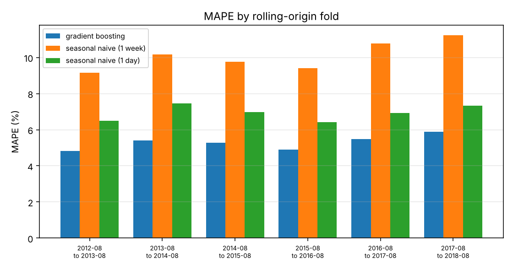
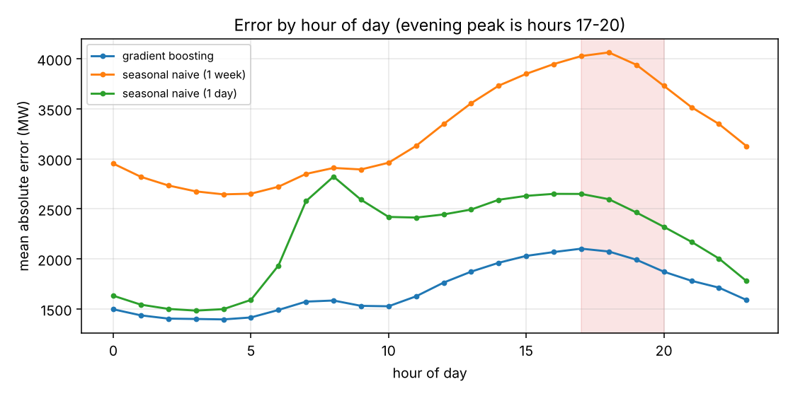
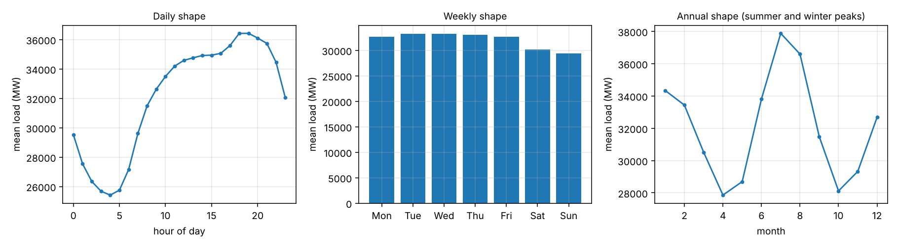
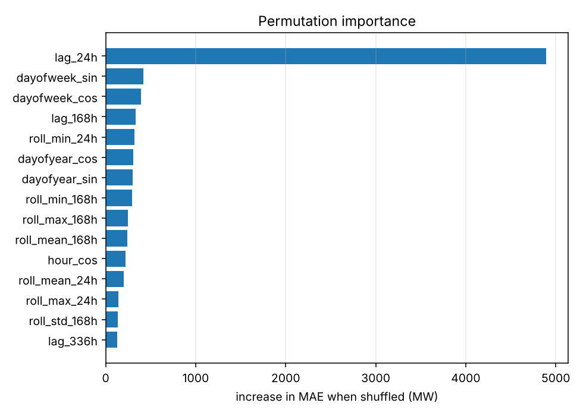

# Load forecasting service

Day-ahead electricity demand forecasting for the PJM East zone, backtested
properly and served behind an API with drift monitoring.

Gradient boosting reaches **5.30% MAPE at a 24-hour horizon**, against
**6.93%** for the strongest naive baseline — a 24% relative reduction, held
across six consecutive years of out-of-sample testing.



---

## Why this is harder than it looks

Electricity load is overwhelmingly periodic. That makes it easy to post an
impressive-looking number and hard to post a meaningful one, for three
reasons, and this repo is organised around all three.

**A naive forecast is already good.** "Same hour yesterday" gets 6.93% MAPE on
this series. Any model that does not beat that comfortably has learned
nothing, and comparing against a mean or a linear trend instead — as portfolio
projects often do — hides it.

**Lag features leak the future unless you stop them.** A day-ahead forecast is
issued before the day starts, so the most recent observed load is at least 24
hours old. A model given `lag_1` to predict 24 hours ahead reports a
spectacular MAPE and cannot be deployed, because at run time that value does
not exist. Here the feature builder **raises** rather than warns:

```python
>>> FeatureSpec(horizon=24, lag_offsets=(0,), absolute_lags=(1,)).validate()
LeakageError: lags [1] are shorter than the 24 hour forecast horizon;
those values are not observable when the forecast is issued
```

**One train/test split measures one year.** Demand grew through the 2000s and
flattened as efficiency and rooftop solar spread. A model evaluated only on
2016 tells you about 2016.

## Results

Six expanding-window folds, each trained on everything before a cut-off and
tested on the following unseen year. Horizon 24 hours.

| Model | MAE (MW) | MAPE | MASE | Peak-hour MAE | MAPE spread |
|---|---:|---:|---:|---:|---:|
| **Gradient boosting** | **1695** | **5.30%** | **0.574** | **2010** | ±0.36 |
| Seasonal naive (1 day) | 2199 | 6.93% | 0.745 | 2507 | ±0.38 |
| Seasonal naive (1 week) | 3255 | 10.08% | 1.101 | 3939 | ±0.73 |

Per fold, so you can see it is not one lucky year:

| Test year | GBM | Naive (1d) | Naive (1w) |
|---|---:|---:|---:|
| 2012–13 | 4.82% | 6.50% | 9.14% |
| 2013–14 | 5.41% | 7.45% | 10.15% |
| 2014–15 | 5.28% | 6.99% | 9.76% |
| 2015–16 | 4.90% | 6.42% | 9.41% |
| 2016–17 | 5.48% | 6.92% | 10.77% |
| 2017–18 | 5.90% | 7.32% | 11.22% |

Notes on the metrics, because the choice is not neutral:

- **MASE is the one to judge on.** It divides error by a seasonal naive
  forecast's error on the *training* data, so 0.574 means "about 43% less
  error than seasonal naive" on a scale that does not move with the units or
  the load level. MAPE is reported because the industry reports it, but it is
  asymmetric and inflates when load is low.
- **Peak-hour MAE is reported separately** (hours 17–20). Grid operators set
  reserve margins and buy spot power against the evening peak. A model that is
  accurate on average and poor at 6pm is not a useful model.
- **The spread across folds is reported**, because a mean over six folds
  without its variance is half a result.



## The data, and what cleaning it requires

Real PJM East hourly metered load: **145,366 observations, January 2002 to
August 2018, 14.5 to 62.0 GW**.

The timestamps are naive local time, which means both daylight-saving
artefacts are present in the raw file:

```
145366 raw rows spanning 2002-01-01 to 2018-08-03;
4 duplicate timestamps averaged (DST fall-back),
30 hours absent from the grid, 30 interpolated, 0 left missing
```

Neither is cosmetic. A lag of "24 hours" computed by row offset stops being 24
hours the moment a row is missing or doubled, so the series is reindexed onto
a complete hourly grid and every lag is taken by timestamp.

Gaps are filled only if the **whole run** is short. `Series.interpolate(limit=n)`
does something subtly worse: given a ten-hour outage it fills the first `n`
hours and leaves the rest, so a gap that should have been rejected whole comes
back partly invented. Whether a gap is fillable is a property of the entire
run, so runs are measured first and only short ones are filled.



## How it works

**27 features, all observable at issue time.** Lags at 24–26, 47–49, 168 and
336 hours; rolling mean, standard deviation, min and max over 24-hour and
168-hour windows ending at the horizon; a week-on-week delta; and calendar
features — hour, day of week, month and day of year encoded as sine/cosine
pairs so hour 23 is adjacent to hour 0, plus weekend and US federal holiday
flags. Calendar features are exempt from the lag rule, correctly: the date of
a public holiday is known years ahead.

**Gradient boosting with an absolute-error objective.** Trees rather than a
network because 145k rows of 27 tabular features is squarely where boosted
trees win, they fit in seconds on a CPU, and permutation importance answers
"why did the forecast move". Absolute error rather than squared because load
has genuine extreme days — heat waves, storms — and a squared loss lets a
handful of them pull the whole fit. The reported metric is MAE, so the
objective is MAE.

Permutation importance, in MW of extra MAE when a feature is shuffled:

| Feature | MW |
|---|---:|
| `lag_24h` | 4895 |
| `dayofweek_sin` | 418 |
| `dayofweek_cos` | 395 |
| `lag_168h` | 336 |
| `roll_min_24h` | 322 |
| `dayofyear_cos` | 307 |

Yesterday's load at the same hour carries an order of magnitude more than
anything else, which is both unsurprising and a useful sanity check: a model
whose top feature was `month_sin` would be one to distrust. After that comes
day of week -- the weekday/weekend split -- then last week's load and the
annual cycle.



**One engineering note.** Computing that importance takes 7 seconds with
native threads capped at 2, and over 100 minutes uncapped. The work is
identical; the difference is OpenMP spin-wait between several hundred short
predictions, each far too small to amortise waking every core.
`importances()` caps the thread pool itself rather than leaving it to the
caller, because the uncapped failure mode looks like a hang rather than a
misconfiguration.

## Serving it

```bash
loadfc serve      # or: docker compose up --build
```

| Endpoint | Purpose |
|---|---|
| `POST /forecast` | Recent observed load in, next hours out |
| `GET /health` | Liveness, and which artefact is loaded |
| `GET /drift` | PSI and KS of recent requests against training data |
| `GET /metrics` | Prometheus exposition format |

**The service refuses rather than guesses.** A request whose history is too
short, has a gap, has duplicate timestamps, or asks for more hours than the
model's horizon gets a 422 naming the rule it broke. A forecasting service
that silently produces plausible numbers from insufficient input is worse than
one that errors, because nothing downstream can tell the difference.

```bash
curl -s localhost:8000/forecast -H 'Content-Type: application/json' \
  -d '{"history": [{"timestamp": "2018-06-01 00:00:00", "load_mw": 31000}, ...], "steps": 24}'
```

**Drift monitoring is built into the serving path**, not a separate batch job.
Every served request goes into a ring buffer that `/drift` scores against the
training distribution with Population Stability Index and a two-sample
Kolmogorov–Smirnov test, and the largest PSI is exported as a Prometheus gauge.
PSI bands follow the industry convention: below 0.10 stable, 0.10–0.25
moderate, above 0.25 significant.

Drift detection cannot tell you the model is wrong. It tells you the data no
longer resembles what the model was fitted on, which is a reason to look — and
for a forecaster that otherwise fails silently, that is worth a lot.

`docker compose up` brings up the API with Prometheus already scraping it.

### Measured, not assumed

Against the running service on 4 CPU cores:

| | |
|---|---|
| Single request, 24-hour forecast | **39 ms** |
| 200 requests at concurrency 8 | 15.1 req/s, **p50 525 ms**, p95 645 ms, 0 failures |

The gap between 39 ms alone and 525 ms under eight concurrent clients is the
honest shape of a single-worker Python service: feature construction is
CPU-bound and holds the GIL, so concurrency queues rather than parallelises.
Production would run one worker per core behind a load balancer. The
single-request figure describes the model; the concurrency figure sizes the
deployment.

The drift endpoint was exercised the same way. Posting a history drawn
entirely from June, against a model trained across all months, returns:

```json
{"status": "significant", "worst_feature": "month_cos", "worst_psi": 12.97}
```

which is the detector doing exactly its job: the input distribution no longer
resembles training, and it says so before anyone notices the forecasts are
off.

## Reproducing

```bash
pip install -e ".[dev]"
```

```bash
make all
```

Downloads the series (~4 MB), runs the six-fold backtest, fits the final model
and exports serving artefacts, and writes `reports/`. Around 15 minutes on 4
CPU cores.

```bash
pytest
```

## Honest limits

- **No weather.** This is the big one. Electricity load is driven by
  temperature more than by anything else, and a day-ahead forecast with
  weather forecasts as inputs would beat 5.30% comfortably. The series used
  here carries load only. Adding a temperature feed is the single highest-value
  change and is not done.
- **One horizon.** Everything is trained and evaluated at 24 hours. Operators
  want 1 hour to 7 days, which means either several models or a direct
  multi-horizon formulation.
- **Point forecasts only.** Reserve planning needs intervals, not a single
  number. Quantile regression over the same features would give them cheaply.
- **The data ends in 2018.** Nothing here has seen COVID demand patterns, and
  that is exactly the kind of regime change the drift endpoint exists to flag.
- **Drift is monitored on inputs, not outcomes.** Prediction error against
  realised load is the signal that actually matters; it needs the actuals to
  arrive, which this service does not yet ingest.

## Layout

```
src/loadfc/
  data.py       download, DST handling, gap policy
  features.py   leakage-safe feature construction (raises, not warns)
  baselines.py  seasonal naive, with a horizon guard
  model.py      gradient boosting and permutation importance
  backtest.py   rolling-origin evaluation
  metrics.py    MAE, RMSE, MAPE, MASE, peak-hour MAE
  drift.py      PSI and KS monitoring
  service.py    FastAPI, Prometheus, /drift
  plots.py      figures
  cli.py        `loadfc <stage>`
scripts/loadtest.py   latency percentiles against a running service
tests/          70 tests, including the leakage and refusal cases
```

## Licence

MIT.
