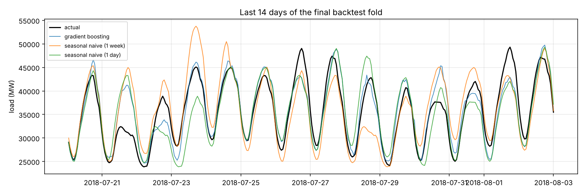

# Results

Data: 145366 raw rows spanning 2002-01-01 to 2018-08-03; 4 duplicate timestamps averaged (DST fall-back), 30 hours absent from the grid, 30 interpolated, 0 left missing

Forecast horizon: 24 hours. 6 expanding-window folds, each tested on one unseen year.

| Model | MAE (MW) | MAPE | MASE | Peak-hour MAE | MAPE spread |
|---|---:|---:|---:|---:|---:|
| gradient boosting | 1695 | 5.30% | 0.574 | 2010 | ±0.36 |
| seasonal naive (1 week) | 3255 | 10.08% | 1.101 | 3939 | ±0.73 |
| seasonal naive (1 day) | 2199 | 6.93% | 0.745 | 2507 | ±0.38 |

